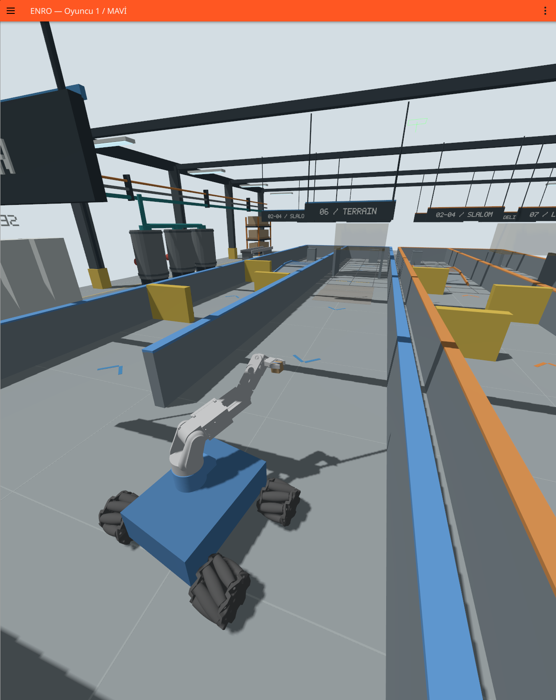

# ENRO Two Player Robot Cargo Race

ROS 2 Jazzy ve Gazebo Harmonic içinde iki gamepad ile oynanan fiziksel kargo yarışı.
İki oyuncu **aynı simülasyon dünyasında**, kendi Gazebo penceresinden mekanum
tabanlı robotunu sürer; kutuyu gerçek parmak temasıyla kavrayıp parkurdan geçirir.
Geçerli teslimatı ilk yapan kazanır.



**Ana oyun LLM, API anahtarı, mikrofon veya model indirmesi gerektirmez.**
Eski LLM/persona modları depoda korunur, ancak aşağıdaki kurulum manuel fabrika
yarışı içindir. Proje simülasyondur; gerçek robot için güvenlik sistemi değildir.

## Başlamak için

1. [Bilgisayara kurulum](docs/INSTALLATION.md): Ubuntu, ROS, bağımlılıklar, derleme ve ilk açılış.
2. [Oynanış ve teknik ayrıntılar](factory/README.md): kontroller, parkur, tutuş ve testler.
3. [Bilinen sorunlar ve geliştirme planı](docs/ROADMAP.md): öncelikler ve kabul ölçütleri.
4. [Katkı rehberi](CONTRIBUTING.md): kodun yerleşimi, testler ve hata bildirme.

Kurulumu tamamladıktan sonra depo kökünde:

```bash
./start_factory_game.sh
```

İki gamepad bağlanınca 10 saniyelik kontrol ekranı gösterilir. İki Gazebo
penceresi yan yana yerleşir. Görevli panelindeki **Yeni yarış** sıfırdan
başlatır; **Kapat** oturumu sonlandırır.

## Nasıl oynanır

Önündeki kutuya LT ile kolu indir, RB ile kavra, LB ile kaldır. Masadan yana
çıkıp rampaya hizalan. Köprüyü, üç karşılıklı zikzak açıklığını ve U dönüşünü
tamamla. Engebeli dönüş yolundan ve kolu indirerek alçak geçitten geç.
Başlangıç tarafında, ayırıcı duvarın öbür yanındaki kendi renkli hedefe
kutuyu indirip RT ile bırak.

| Kontrol | İşlem |
|---|---|
| Sol analog | Robotun yönüne göre ileri, geri ve yana hareket |
| Sağ analog yatay | Robotu kendi etrafında döndür |
| Sağ analog dikey | Gripper bölgesine yakınlaş / uzaklaş |
| LB / LT basılı tut | Kolu kaldır / indir |
| RB / RT basılı tut | Gripper'ı kapat / aç |
| Menü / Start / Back | Ortak duraklat / devam |

Omuz tuşlarını bırakınca hedef konum korunur. Test edilen iki kol sistemde
**Logitech Dual Action** olarak görünür. Bütün PlayStation/Xbox kolları için
eşleme doğrulanmış değildir; [cihaz seçimi](docs/INSTALLATION.md) bölümüne bakın.

Kutuyu robota yapıştırma, ışınlama veya otomatik yönlendirme yoktur.
Dönüşte kolu biraz indirip yavaş dönmek gerekir. Kutu düşebilir; şu an yerdeki
kutuyu geri alma akışı yoktur, gerekirse **Yeni yarış** kullanın.

## Mevcut sürüm

- Tek ortak dünya, iki robot ve bağımsız takip kameraları.
- 32 × 26 m endüstriyel tesis; raflar, makineler, konveyör ve iki eşit U parkuru.
- Tam tur testinde yaklaşık 49 m taşıma yolu ve sekiz sıralı kontrol bölümü.
- Gerçek kutu konumu, gripper açıklığı, hız ve kararlılıkla teslimat doğrulaması.
- Kopan gamepad veya duraklatmada ortak sürüş durdurma.
- Çevrimdışı üretilen tesis geometrisi; açılışta harici model indirilmez.

Bu sürüm bir şenlik/prototip oyunudur. Yüksek kolla manevrada yük kayması,
fiziğin gerçek zamandan yavaş çalışması ve gamepad/masaüstü uyumluluğu
başlıca sınırlamalardır. [Ölçümler ve geliştirme planı](docs/ROADMAP.md).

## Geliştirici için dosyalar

| Konum | Sorumluluk |
|---|---|
| `factory/course.py`, `factory/winding.py` | Parkur ölçüleri ve çarpışmalı engeller |
| `factory/facility.py` | Endüstriyel ortamın görselleri |
| `factory/control.py`, `factory/driver.py` | Gamepad, kol, gripper ve ROS komutları |
| `factory/race_rules.py`, `factory/referee.py` | Kontrol noktaları ve kazanan |
| `factory/PlayerCamera.*` | Oyuncuya özel Gazebo kamerası |
| `src/` | Robot açıklamaları, mesh'ler ve eski ROS modları |
| `v2/src/enro_terminal/coop_input.py` | Paylaşılan Linux gamepad okuyucusu |

## Eski modlar

LLM/persona, ses ve işbirlikçi oyun farklı kurulumlara sahiptir:
[Eski modların kurulumu](docs/LEGACY_MODES.md),
[persona oyun rehberi](docs/OYUN_REHBERI.md),
[işbirlikçi şenlik modu](v2/docs/IKI_OYUNCULU_SENLIK.md).

## Kaynak ve lisans

Robot tabanı ve kol kaynakları
[ITU Industrial Robotics Team S Mecanum Wheel](https://github.com/ITU-Industrial-Robotics-Team/S_Mecanum_Wheel)
projesinden geliştirilmiştir. Mevcut [LICENSE](LICENSE) ve bileşenlerin
lisans/atıf bildirimleri korunur. Eski paketlerin bazı lisans metadataları
tutarsızdır; bileşen bazındaki inceleme [geliştirme planında](docs/ROADMAP.md)
yer alır. Üçüncü taraf mesh ve isteğe bağlı AI modellerinin koşullarını ayrıca kontrol edin.
